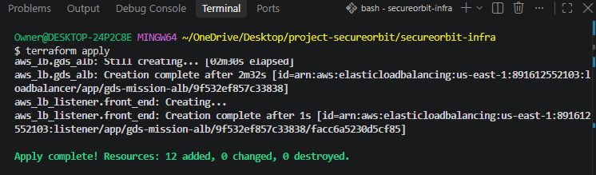
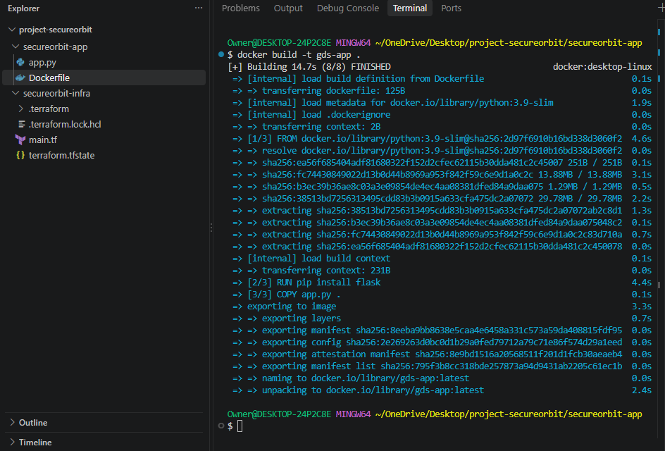
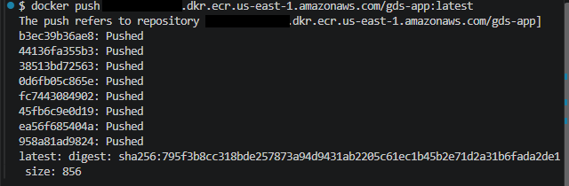
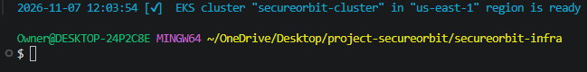
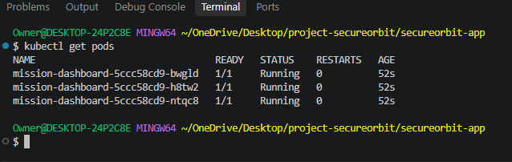

# Project SecureOrbit: High-Availability

# Microservice Infrastructure on AWS

## 🪐 Executive Summary

Project SecureOrbit is an enterprise-grade

deployment framework designed to transition

a critical Python mission dashboard from a

vulnerable local script into a security-hardened,

fault-tolerant containerized fleet on AWS.

### 🛠️ Core Engineering Toolstack

*   **IaC Engine:** HashiCorp Terraform

*   **Containers:** Docker Desktop & BuildKit

*   **Staging Registry:** Amazon ECR

*   **Orchestration Brain:** Amazon EKS

*   **Local Framework:** WSL 2

---

## 🏗️ Technical Execution Breakdown

### 🔹 Part 1: Automated Networks (Terraform)

HashiCorp Terraform was used to model and

provision a custom VPC. The architecture

separates public-facing entry gates from private

compute layers. A total of 12 distinct cloud

assets—including subnets, route tables,

gateways, and a frontend Application Load Balancer

(ALB)—were fully automated.

#### 📊 Execution Proof: Infrastructure Build Metrics

---

### 🔹 Part 2: Application Packaging (Docker)

The raw Python application was packaged using a

multi-layer Docker blueprint to minimize attack

surfaces and eliminate environmental drift. The

application was compiled locally using the Docker

BuildKit engine.

#### 📊 Execution Proof: Container Build Success

---

### 🔹 Part 3: Staging & OpSec (Amazon ECR)

A private, encrypted storage repository was

established within AWS to secure the image blueprint.

A temporary cryptographic authentication bridge was

handshaked between the local Docker daemon and the

cloud registry. All sensitive account numbers have

been systematically masked using clean blackout shapes.

#### 📊 Execution Proof: Hash Registry Push

---

### 🔹 Part 4: Cluster Initialization (Amazon EKS)

To manage the runtime application lifecycle at scale,

a managed Amazon EKS Kubernetes cluster was

initialized using the `eksctl` binary command engine.

The automated control plane manages communication across

worker nodes to handle load scaling natively.

#### 📊 Execution Proof: Managed Cluster Ready State

---

### 🔹 Part 5: Workload Scheduling (Kubernetes)

A cascading YAML deployment manifest contract was

executed to declare the target state of the architecture.

Utilizing a highly automated local AI Copilot configuration

track to guarantee character-perfect structural formatting,

the cluster brain provisioned three concurrent, identical

replicas of the container pod workload. If any single node

suffers an unexpected failure, the cluster immediately

self-heals and scales a replacement clone instantly with

zero human intervention.

#### 📊 Execution Proof: Active Replicated Fleet Grid

---

## 🏆 Problem-Solving Matrix & Outcomes

*   **No Single Point of Failure:** Shifted

    infrastructure to a multi-node cluster hosting 3

    high-availability live replicas.

*   **Environmental Stability:** Sealed application

    runtime layers into an immutable container blueprint,

    guaranteeing exact configuration behavior.

*   **Zero-Trust Border Security:** Sandboxed compute

    nodes inside private subnets, keeping them insulated

    from public web scans while using a monitored load

    balancer gatekeeper at the front door.
